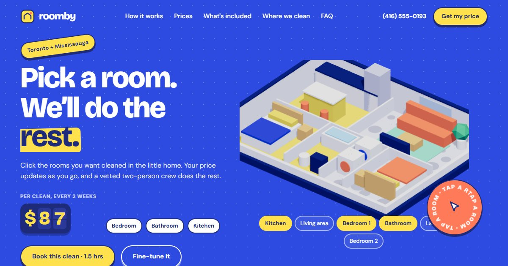

# Roomby Home Cleaning

Website for a room-by-room home cleaning service in Toronto and Mississauga.



## Highlights

- **Book by clicking rooms in 3D.** An isometric, cut-away apartment built with React Three Fiber. Click a room to add it: its grime fades, the dust settles and a burst of sparkles pops out. Hover shows the room and price. Every room also has a matching button for keyboard and screen-reader users.
- **One shared quote.** The 3D home and the price builder edit the same state (a tiny `useSyncExternalStore` store), so the odometer-style price board updates everywhere at once.
- **Price builder.** Type of clean, room counters, extras and frequency discounts, with crew time estimated from per-room minutes.
- **2D sections, each with its own idea:** animated SVG how-it-works scenes, 3D flip cards for plans, a clipboard checklist that ticks itself as you scroll, a shelf of bobbing product bottles, a dot-map postal code checker, and draggable sticky-note FAQs.
- **Booking request drawer** with day and arrival-window pickers, validation (Zod) and a clear "request, not a confirmed booking" message.
- Respects `prefers-reduced-motion`.

## Stack

Vite · React 19 · TypeScript · React Three Fiber + drei · Framer Motion · Zod · plain CSS

## Run

```bash
npm install
npm run dev     # http://localhost:5390
npm run build
```

## Structure

```
src/lib/pricing.ts        services, rooms, extras, frequencies and the price function
src/lib/store.ts          shared quote state used by the 3D home and the builder
src/components/House3D    isometric apartment, clickable rooms, dust and sparkles
src/components/Estimator  price builder
src/components/Sections   plans, checklist, supplies, area check, FAQ notes
src/components/Booking    booking request drawer
```
